# IntentWay DevOps & Systems Architecture

This document provides a comprehensive overview of how **Jira**, **GitHub**, **Jenkins**, **Docker**, and **Nagios** are integrated into the IntentWay software engineering lifecycle.

---

## 1. End-to-End DevOps Architecture Diagram

```mermaid
flowchart TB
    %% ── JIRA AGILITY & ISSUE MANAGEMENT ──────────────────────────
    subgraph JIRA_LAYER ["1. Agile & Project Management (Jira)"]
        direction TB
        JiraEpics["<b>Jira Epics & User Stories</b><br/>IW-1: Foundation & Docker Shell<br/>IW-2: Natural Language Intent Parser<br/>IW-3: PostGIS Spatial Corridor Filter<br/>IW-4: Greedy Route Solver Heuristic<br/>IW-5: Frontend UI & Leaflet Map<br/>IW-9: Nagios Service Monitoring"]
        JiraSprint["<b>Sprint Planning & Kanban Board</b><br/>Backlog ➔ To Do ➔ In Progress ➔ In Review ➔ Done"]
        JiraEpics --> JiraSprint
    end

    %% ── VERSION CONTROL (GIT & GITHUB) ───────────────────────────
    subgraph VCS_LAYER ["2. Source Control & Collaboration (Git / GitHub)"]
        direction TB
        GitBranch["<b>Feature Branching Strategy</b><br/><code>feature/&lt;issue-key&gt;</code> based on <code>develop</code>"]
        GitCommit["<b>Conventional Git Commits</b><br/><code>feat(IW-X): message</code> / <code>fix: message</code>"]
        GitPR["<b>Pull Request & Code Review</b><br/>PR target: <code>develop</code> ➔ <code>main</code>"]
        GitBranch --> GitCommit --> GitPR
    end

    JiraSprint -. "Drives Feature Work" .-> GitBranch

    %% ── CONTINUOUS INTEGRATION (JENKINS) ─────────────────────────
    subgraph CI_LAYER ["3. Continuous Integration Pipeline (Jenkins)"]
        direction TB
        JenkinsTrigger["<b>Build Trigger</b><br/>WebHook on Push / PR"]
        
        subgraph PipelineStages ["Jenkins Pipeline (Jenkinsfile)"]
            StageCheckout["<b>Stage 1: Checkout</b><br/>Pull target branch from GitHub"]
            StageBackend["<b>Stage 2: Backend Dependencies & Tests</b><br/>Create .venv ➔ pip install ➔ pytest (94 tests)"]
            StageFrontend["<b>Stage 3: Frontend Build & Lint</b><br/>npm ci ➔ vite build ➔ oxlint"]
        end

        JenkinsStatus["<b>CI Build Status Feedback</b><br/>Blue (Success) / Red (Failure)"]

        JenkinsTrigger --> StageCheckout --> StageBackend --> StageFrontend --> JenkinsStatus
    end

    GitPR ==>|Automated Trigger| JenkinsTrigger
    JenkinsStatus -. "Quality Gate Feedback" .-> GitPR

    %% ── CONTAINERIZED ENVIRONMENT (DOCKER) ───────────────────────
    subgraph DOCKER_LAYER ["4. Containerized Microservices (Docker Compose)"]
        direction TB

        subgraph DockerNetwork ["Isolated Bridge Network: intentway-network"]
            direction LR

            FrontendContainer["<b>intentway-frontend</b><br/>React 19 + Vite + Leaflet<br/>Port: 5173"]
            BackendContainer["<b>intentway-backend</b><br/>FastAPI + Python 3.11<br/>Port: 8000"]
            PostgresContainer["<b>intentway-postgres</b><br/>PostgreSQL 16 + PostGIS 3.4<br/>Port: 5432<br/>79 Mumbai POIs Volume"]

            FrontendContainer <-->|REST API JSON| BackendContainer
            BackendContainer <-->|Spatial Queries ST_Intersects| PostgresContainer
        end

        DockerCompose["<b>docker-compose.yml Orchestrator</b><br/>Container lifecycle, named volumes & networks"]
        DockerCompose --> FrontendContainer
        DockerCompose --> BackendContainer
        DockerCompose --> PostgresContainer
    end

    JenkinsStatus ==>|Verified Code Deployed| DockerCompose

    %% ── INFRASTRUCTURE MONITORING (NAGIOS) ────────────────────────
    subgraph MONITORING_LAYER ["5. Infrastructure & Service Monitoring (Nagios Core)"]
        direction TB

        NagiosContainer["<b>Nagios Core Container</b><br/>jasonrivers/nagios<br/>Web Portal: Port 8080"]

        subgraph NagiosChecks ["Continuous Health Probes (Every 60s)"]
            CheckFrontend["check_tcp!5173<br/>Frontend React App"]
            CheckBackend["check_tcp!8000<br/>FastAPI Health API"]
            CheckPostgres["check_tcp!5432<br/>PostGIS Database"]
        end

        NagiosContainer --> CheckFrontend
        NagiosContainer --> CheckBackend
        NagiosContainer --> CheckPostgres

        CheckFrontend -.->|TCP Active Probe| FrontendContainer
        CheckBackend -.->|TCP Active Probe| BackendContainer
        CheckPostgres -.->|TCP Active Probe| PostgresContainer

        NagiosAlerts["<b>Alerting & Reporting</b><br/>States: UP, WARNING, CRITICAL<br/>Soft/Hard Alert Transitions"]
        NagiosChecks --> NagiosAlerts
    end

    DockerCompose --> NagiosContainer
    NagiosAlerts -. "Defects / Downtime Logged" .-> JiraSprint

    %% ── STYLING ──────────────────────────────────────────────────
    classDef jira fill:#0052cc,stroke:#ffffff,stroke-width:2px,color:#ffffff;
    classDef git fill:#f34f29,stroke:#ffffff,stroke-width:2px,color:#ffffff;
    classDef jenkins fill:#d33833,stroke:#ffffff,stroke-width:2px,color:#ffffff;
    classDef docker fill:#0db7ed,stroke:#ffffff,stroke-width:2px,color:#ffffff;
    classDef nagios fill:#11a049,stroke:#ffffff,stroke-width:2px,color:#ffffff;
    classDef default fill:#1e293b,stroke:#475569,stroke-width:1px,color:#f8fafc;

    class JiraEpics,JiraSprint jira;
    class GitBranch,GitCommit,GitPR git;
    class JenkinsTrigger,StageCheckout,StageBackend,StageFrontend,JenkinsStatus jenkins;
    class DockerCompose,FrontendContainer,BackendContainer,PostgresContainer docker;
    class NagiosContainer,CheckFrontend,CheckBackend,CheckPostgres,NagiosAlerts nagios;
```

---

## 2. Pillar-by-Pillar Explanation Guide

### Pillar 1: Jira (Agile & Issue Tracking)
* **Role**: Serves as the central project management backbone where the semester project was decomposed into manageable user stories.
* **Key Mechanisms**:
  * **Issue Decomposition**: Stories are tagged with unique keys (e.g., `IW-1` to `IW-9`), each with defined acceptance criteria and Definition of Done.
  * **Traceability**: Every Git branch (`feature/route-solver`, `feature/nagios-monitoring`) and commit message correlates directly to a Jira ticket.
  * **Agile Sprints**: Features move through Kanban states: *Backlog ➔ To Do ➔ In Progress ➔ In Review ➔ Done*.

---

### Pillar 2: Jenkins (Continuous Integration Pipeline)
* **Role**: Acts as the automated quality gate verifying that new code does not break tests or builds before merging.
* **Pipeline Configuration (`Jenkinsfile`)**:
  1. **Stage 1: Checkout**: Pulls the active branch from the GitHub repository.
  2. **Stage 2: Backend Dependencies & Tests**: Initializes a clean Python environment, installs dependencies from `requirements.txt`, and executes the full **pytest test suite (94 tests)**.
  3. **Stage 3: Frontend Build & Lint**: Runs `npm ci`, executes production bundle compilation (`vite build`), and checks syntax with `oxlint`.
* **Value**: Catches regression bugs early and guarantees that only verified code reaches `main`.

---

### Pillar 3: Docker & Docker Compose (Containerization)
* **Role**: Guarantees identical execution environments across development and presentation without machine-specific dependency conflicts.
* **Architecture**:
  * **`intentway-postgres`**: PostgreSQL 16 + PostGIS 3.4 spatial database holding 79 curated Mumbai POIs with a persistent named volume (`postgres-data`).
  * **`intentway-backend`**: FastAPI application exposing `/health` and `/api/route/plan` on port `8000`.
  * **`intentway-frontend`**: React 19 + Leaflet map client on port `5173` with live hot-reloading (`usePolling`).
  * **`intentway-network`**: Isolated Docker bridge network providing secure, internal service-to-service DNS resolution (`postgres`, `backend`, `frontend`).

---

### Pillar 4: Nagios Core (Infrastructure & Service Monitoring)
* **Role**: Real-time health monitoring and SLA verification of the deployed containers.
* **Configuration (`monitoring/nagios/`)**:
  * **`hosts.cfg`**: Defines host definitions for `intentway-backend`, `intentway-frontend`, and `intentway-postgres`.
  * **`services.cfg`**: Runs active TCP probes every 60 seconds against port 8000 (API), port 5173 (Web), and port 5432 (PostGIS).
  * **Dashboard**: Web interface on `http://localhost:8080/nagios/` showing real-time host status, state duration, and alert logs (SOFT/HARD alert escalation).

---

## 3. Presentation & Viva Talking Points

When presenting this architecture, follow this narrative:

1. **Agile Planning**: *"We organized our development cycle using Jira stories (IW-1 to IW-9), ensuring every commit and pull request was traceable to specific project requirements."*
2. **Automated CI/CD**: *"Whenever code was pushed to GitHub, our Jenkins pipeline automatically checked out the repository, ran all 94 backend tests, and executed the frontend build to ensure zero regressions."*
3. **Containerized Deployment**: *"Using Docker Compose, we containerized our frontend, backend, PostGIS spatial database, and Nagios monitoring into isolated, reproducible containers on a shared bridge network."*
4. **Proactive Monitoring**: *"To ensure high availability and demonstrate DevOps operations, we configured Nagios Core to continuously ping and monitor all three microservices, providing visual dashboard status and failure alerts."*
